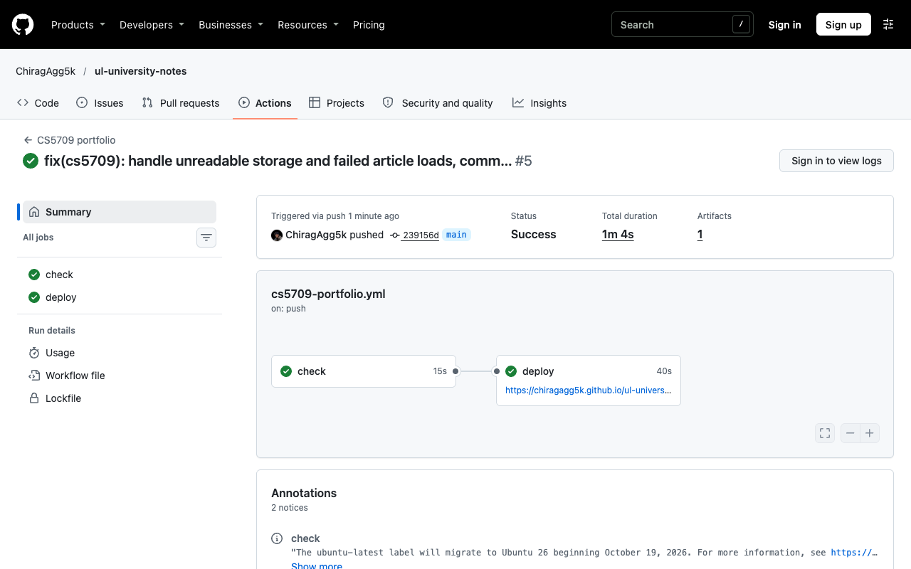
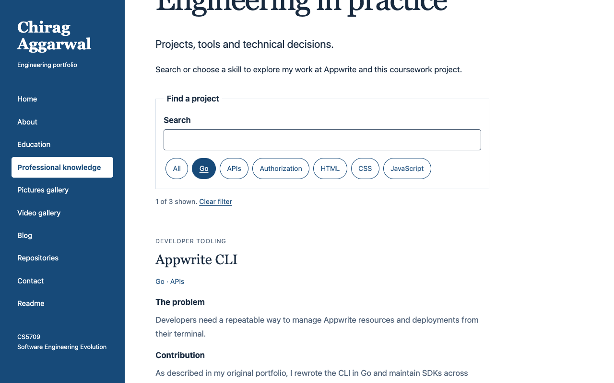
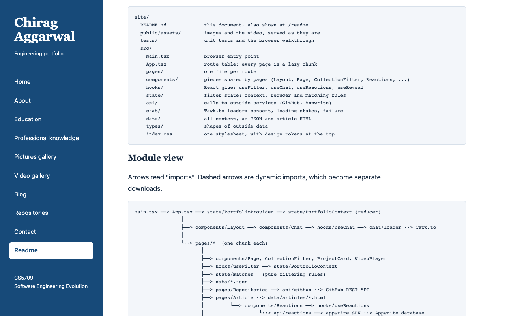
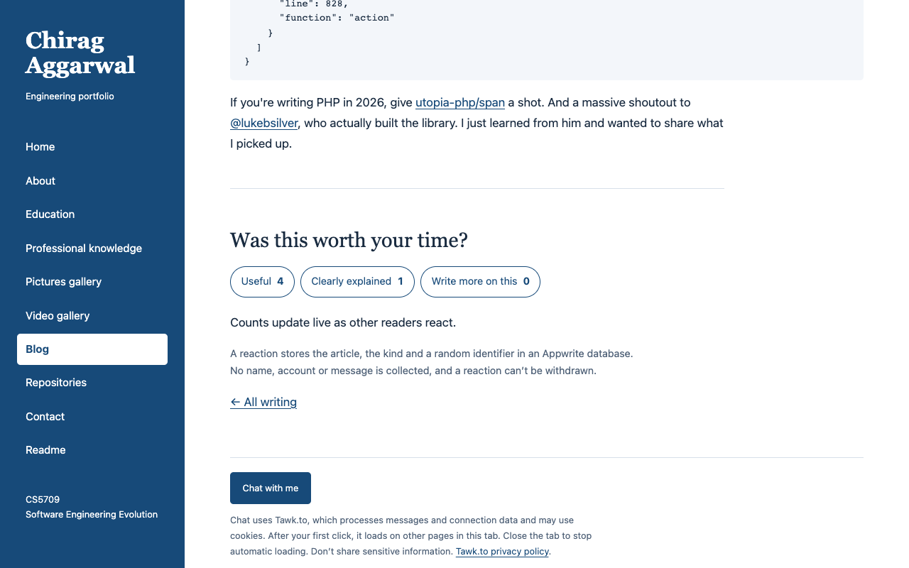
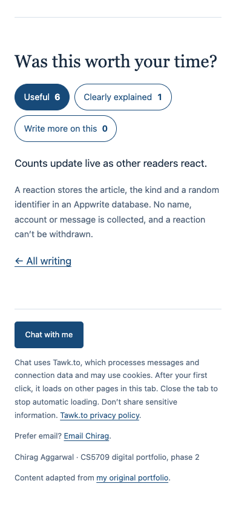
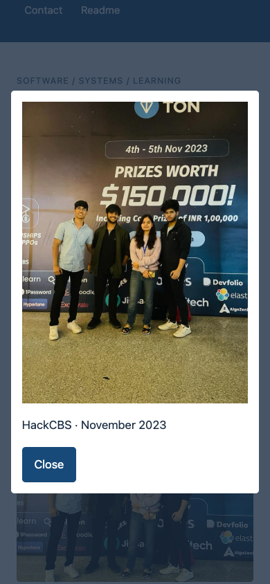
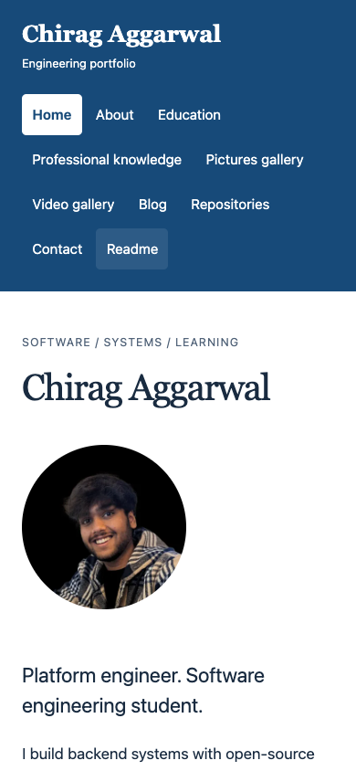
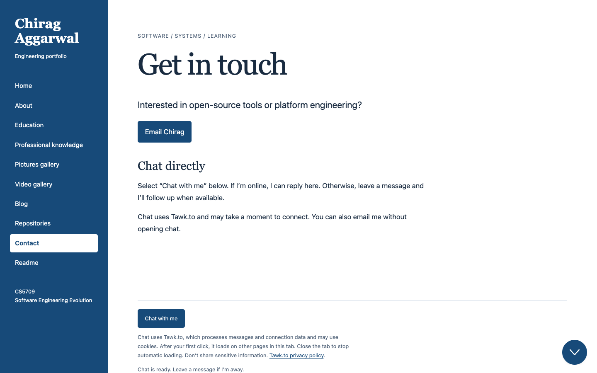
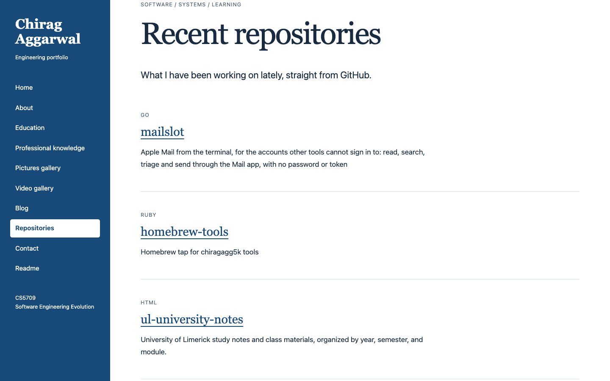

## Summary

Phase 2 turns the Phase 1 static site (24 files generated by a Node.js script) into a React 19 and strict TypeScript application with 13 pages, live on GitHub Pages. Content now sits in typed JSON files and standalone article HTML documents rather than template strings, while Vite 8, React Router 7 and GSAP 3 handle bundling, lazy-loaded routes and motion-safe transitions. The changes answer the Assessment 1 feedback and the Assessment 2 peer review, both of which asked for requirements derived from personas and scenarios, comments that explain code structure, a more structured evaluation and a Readme page. Three proto-personas, eight scenarios and a review of four existing portfolios now drive eleven requirements, each traced to its source file, and `/readme` renders the repository's `README.md` directly so the two cannot drift.

A GitHub Actions pipeline lints with oxlint, checks Prettier formatting, runs 19 unit tests, verifies types, builds and deploys passing commits to GitHub Pages in about a minute. Beyond class coverage, articles feature reactions stored in an Appwrite database using deterministic row identifiers and table permissions without a custom server, with live counts pushed over websockets, alongside a Repositories page fed by the GitHub REST API. Evaluation combined a Fagan-style code inspection, which logged twelve defects across 38 files (six fixed, three accepted and three open), with a Playwright walkthrough of the live deployment. All eight scenarios pass on the live site at desktop and phone widths. However, the personas remain assumptions and no real users tested the site.

## 1. Declaration and transparency

This report and the website it describes are submitted for CS5709 Assessment 3. The website is the second phase of the portfolio I submitted for Assessment 1.

### Reused material

The biography, work history, education details, three event photographs, the explainer video and both blog articles are carried over from Phase 1. Phase 1 adapted them from my personal portfolio at https://www.chiragaggarwal.tech. They are evidence of my professional work, not writing produced for this module. The application code, tests, pipeline and documentation described here were written for this assessment.

### Use of generative AI

I used an AI coding assistant (Claude Code) throughout this assessment. It helped me interpret the brief and both reviews, write and refactor the application code and tests, set up the database and the deployment pipeline, run the browser walkthrough, and draft the factual sections and tables of this report. The summary, the critique and the reflection are my own writing. The decisions recorded in this report are mine, and I am responsible for all of it.

## 2. Enhanced based on peer review

Phase 1 received two reviews: the lecturer's feedback on Assessment 1 (12 out of 15) and a peer review written for Assessment 2 by {{reviewer}}. This section lists every recommendation, what was done about it, and the recommendations that no longer apply. Section 2.4 then presents the discovery work that both reviews asked for.

### 2.1 Lecturer feedback on Phase 1

| Area | Comment | Response in Phase 2 |
| --- | --- | --- |
| Discovery (2/3) | "The discovery process should be based on real-world cases, including scenarios, personas, and existing case reviews. Currently, the requirements are determined solely by the developer." | Four existing portfolios reviewed, three personas and eight scenarios written, eleven requirements derived from them (Section 2.4) |
| Design (3/3) | "The structure is good. However, a clear human-centred design approach is needed." | The work follows the human-centred design cycle of ISO 9241-210 (2019): context of use (personas), requirements, design, evaluation against the same scenarios (Section 5.3) |
| Development, iterations 1 and 2 (2/3 each) | "The code structure should be explained in the code comments." | Every source file opens with a `@file` comment that says what it is for and why it is built that way; exported functions carry JSDoc; the stylesheet has a comment per section. Comment lines rose from 2% to 12% of the code |
| Evaluation (3/3) | "The review can be more structured and academic." | A code inspection with entry and exit criteria, a checklist and a defect log, and a scenario walkthrough with recorded results (Section 5) |
| Overall | "…the code should include more comments and be divided into clear sections." | One concern per folder under `src/` (Section 3.1) |

### 2.2 Peer review: actionable recommendations

The peer review listed eight actions in priority order and logged seven defects.

| # | Recommendation | What was done | State |
| --- | --- | --- | --- |
| 1 | Add a Readme page to the site that explains pages, build and folders | New `/readme` route. It renders the `README.md` that sits beside the source, so the page and the file cannot disagree | Done |
| 2 | Add two personas and four scenarios; trace every feature to one | Three personas, eight scenarios, eleven traced requirements (Section 2.4) | Done |
| 3 | Analyse the lecturer's provided portfolio: what was kept or dropped | See the note below this table | Not carried out |
| 4 | Add a module view recovered from the code; show tests in the diagrams | Module view in the Readme page and in Section 3.1, drawn from the import statements | Done |
| 5 | Header comment in every module; fix defects D1 to D7 | 38 of 38 code files have a header comment. Defects: Section 2.3 | Done |
| 6 | Run build and tests in GitHub Actions on every push | The pipeline runs lint, format check, 19 unit tests, type check and build on every push that changes the site, on any branch; only `main` deploys (Section 3.2) | Done |
| 7 | Move the articles out of code; refactor `chat.mjs` | Articles are separate HTML files loaded on demand, no longer strings inside modules. The chat loader is a store with five named states and no import-time side effects | Done, with one change: HTML kept instead of Markdown, because the articles contain figures and code blocks that were already valid HTML |
| 8 | Split the README into technical documentation and working notes | `site/README.md` is the technical document in the four sections the reviewer proposed; the assessment checklist and submission details moved to `NOTES.md` | Done |
| | Galleries are thin: three photos, one video, three projects | A Repositories page now lists my six most recently updated public repositories from the GitHub API, so the site shows current work without manual editing. The photo, video and case-study counts are unchanged | Partly |

**Note on recommendation 3.** Phase 1 was built from my own personal website (`chiragaggarwal.tech`) rather than from the lecturer's provided starter portfolio, and this was declared in Section 1 of the Phase 1 report. Because the codebase never shared files or commit history with the provided starter, a keep-or-drop analysis against that repository was not carried out. Instead, Section 2.4 reviews my original website alongside three external engineering portfolios to show what this phase kept, dropped and added.

### 2.3 Peer review: recommendations that no longer apply

The seven defects were logged against Phase 1 files. Phase 2 replaced those files, so each defect was checked against the new code.

| Defect | Phase 1 problem | Phase 2 |
| --- | --- | --- |
| D1 | Status text "3 of 3 projects shown." typed by hand | Fixed by design: `CollectionFilter` computes both numbers |
| D2 | Skills parsed from a `data-skills` attribute on every click | Not applicable: components read typed JSON imports; there is no HTML data contract |
| D3 | Missing null check before writing the status text | Not applicable: React renders the status; no element lookup |
| D4 | Chat states as free strings in mutable module state | Partly applicable: the states are now the `ChatStatus` union type, checked at compile time. The state is still held in the module, on purpose: it is an external store read with `useSyncExternalStore`, because the widget outlives any one component |
| D5 | The chat module ran on import | Fixed: importing `chat/loader.ts` does nothing; `useChat` calls `load` from an effect |
| D6 | Undocumented HTML contract; the string "All" repeated in four files | Fixed: one `everyTag` constant; no HTML contract |
| D7 | Browser scripts listed by hand in the build | Not applicable: Vite bundles from the import graph |

Two further suggestions were not adopted. An HTML validator in the pipeline was suggested for hand-written pages; the pages are now JSX, so the compiler checks their syntax and types. That is not the same as checking HTML conformance or accessibility, which no automated tool in the pipeline covers; the walkthrough checks a few accessibility behaviours by hand-written assertion. Running "the 26 tests" was suggested; those tests exercised the Phase 1 build script, which no longer exists, so 19 new unit tests and 8 browser scenarios replace them.

### 2.4 Discovery, redone

#### Existing portfolios reviewed

Four portfolios were read on 10 November 2026 to see how working engineers present themselves, before deciding what this site needs.

| Portfolio | What it does | What this site takes from it |
| --- | --- | --- |
| Chiang (2026), brittanychiang.com | One page in four sections: About, Experience, Projects, Writing. Every role and project carries technology tags. Links to a full résumé and a project archive | Tags on every item let a reader match a skill to evidence at a glance. This site goes one step further and makes the tags a filter |
| Robinson (2026), leerob.com | A short biography, a list of notes and a dated list of articles. Almost no decoration | Writing is treated as primary evidence, listed with dates. This site keeps a dated blog index and makes it searchable |
| Comeau (2026), joshwcomeau.com | The home page leads with the newest article and a "read more" link | Newest work first. This site adds a Repositories page fed by the GitHub API so recent work appears without editing |
| Aggarwal (2026), chiragaggarwal.tech (my own, the source of the content) | One long page of cards and skill badges | Its weakness is that nothing can be searched or filtered and an article cannot be reached from the page structure in one step. Separate routes and a filter answer that |

These reviews are of each site's main pages, read once; they are not a survey of every feature those sites have.

#### Personas

The personas are proto-personas (Cooper, 2004): they are built from the brief, the two reviews and the portfolios above, not from interviews. Section 5.5 returns to this limit.

| | P1: Module assessor | P2: Hiring manager | P3: Fellow developer |
| --- | --- | --- | --- |
| Who | A lecturer marking many portfolios against a rubric | An engineering manager screening candidates for a backend role | An engineer who was sent a link to one of my articles |
| Time and device | About 15 minutes, desktop | About 2 minutes, often a phone | As long as the article holds them, usually a phone; sometimes keyboard only |
| Goal | Confirm that each item in the brief exists and works | Find proof of one specific skill, and real code behind it | Read the article, judge whether the author is worth following, perhaps respond |
| Frustration | Features claimed in a report that cannot be found on the site | Portfolios that list skills with no evidence attached | Having to create an account or write a message just to say "this helped" |
| Source | The brief and rubric; the peer reviewer's walkthrough, which failed to find a Readme page | The peer reviewer's second persona; tag-led portfolios such as Chiang (2026) | Articles are shared as direct links; writing-led portfolios such as Robinson (2026) |

#### Scenarios

Each scenario is a short story of one persona reaching one goal (Carroll, 2000). The same eight scenarios are replayed in the evaluation.

| ID | Persona | Scenario |
| --- | --- | --- |
| S1 | P1 | Opens the home page and looks for the Readme page to understand the folder structure |
| S2 | P1 | Opens instant messaging, and checks that nothing is loaded from the chat provider before agreeing |
| S3 | P2 | Wants evidence of Go work and the source code behind it |
| S4 | P2 | Searches the writing for "logging", reads the article, and expects to return to the same results |
| S5 | P3 | Opens an article from a shared link on a phone, reacts to it, and expects the count to be shared with other readers |
| S6 | P3 | Uses only the keyboard to reach what I have been working on lately, and to skip the menu |
| S7 | P2 | On a phone, looks at hackathon photos and enlarges one |
| S8 | Any | On a phone, opens every page in the menu |

#### Requirements derived, and where each one lives

| ID | Requirement | From | Implemented in |
| --- | --- | --- | --- |
| R1 | The Readme page is one action from any page | P1, S1 | `pages/Readme.tsx`, `data/navigation.json` |
| R2 | Chat loads nothing before consent and always reports its state | P1, S2 | `chat/loader.ts`, `components/Chat.tsx` |
| R3 | A skill leads to its evidence in at most three actions | P2, S3 | `components/CollectionFilter.tsx`, `state/matches.ts` |
| R4 | Writing can be searched, and a filter survives navigation | P2, S4 | `state/PortfolioContext.ts`, `hooks/useFilter.ts` |
| R5 | A direct link to an article works, and the article reads well on a phone | P3, S5 | `App.tsx` (route), `404.html` copy in the build, `index.css` |
| R6 | A reader can respond to an article without an account or a message | P3, S5 | `components/Reactions.tsx`, `hooks/useReactions.ts`, `api/reactions.ts` |
| R7 | The site works from the keyboard: skip link first, focus follows navigation | P3, S6 | `components/Layout.tsx` |
| R8 | Recent work is visible without manual updates | P2, P3, S6 | `api/github.ts`, `pages/Repositories.tsx` |
| R9 | Photos can be filtered and enlarged on a phone | P2, S7 | `pages/Pictures.tsx` |
| R10 | No page scrolls sideways at 390 pixels | All, S8 | `index.css` |
| R11 | Motion is never forced on a visitor who asked for less | All | `hooks/useReveal.ts` |

Non-functional requirements are part of the table (R5, R7, R10, R11), which answers the peer reviewer's point that Phase 1 listed none.

## 3. Development

### 3.1 Iteration 3: enhancement based on the Phase 1 reviews

Phase 1 generated static pages with a Node script. That was easy to explain but could not meet the Phase 2 brief, which asks for typed components, JSON-driven data, shared state, an API connection, lazy loading and animation. Iteration 3 rebuilt the site as a React application and carried every Phase 1 page across.

| | Phase 1 | Phase 2 |
| --- | --- | --- |
| Approach | Static HTML generated at build time | Single-page application |
| Stack | Node 22, no packages | Vite 8, React 19, TypeScript 7 (strict), React Router 7, GSAP 3 |
| Pages | 11 | 13: the same 11, plus Repositories and Readme, served by 12 routes (one route serves both articles) |
| Content | JavaScript modules holding HTML strings | Seven JSON files and two article HTML files in `src/data/` |
| Code files | 24 files, 1,656 lines | 38 files, 1,980 lines, plus a 560-line stylesheet |
| Comment lines | 31 (2%) | 232 (12%); every file has a header comment |
| Search and filter | Skill filter on one page | Search box and tag filter on projects, articles and photos |
| State | None shared | Reducer and context; chat and reactions as stores |
| Outside services | Tawk.to chat | Tawk.to chat, GitHub REST API, Appwrite database and realtime |
| Tests | 26, against the build script | 19 unit tests, 8 browser scenarios |
| Deployment | Manual, Appwrite Sites | Automatic on every push to `main` that changes the site, GitHub Pages |

#### How each item in the brief was met

| Brief item | Where | How |
| --- | --- | --- |
| Modular structure | `src/{pages,components,hooks,state,api,chat,data,types}` | One concern per folder. A page never calls an outside service directly; it uses a hook, and the hook uses `api/` or `chat/` |
| Dynamic data with JSON | `src/data/*.json` | Profile, education, projects, photos, videos, posts and the menu. Adding a project is a JSON edit; the tag buttons and counts follow |
| API connection | `src/api/github.ts` | Six most recently updated repositories from the GitHub REST API, with loading and failure states and request cancellation |
| GSAP | `src/hooks/useReveal.ts` | Staggered entrance of list items, re-run when a filter changes; skipped under `prefers-reduced-motion` |
| TypeScript | whole project | Strict mode; the build fails on any type error. JSON shapes are inferred, so a missing field is a compile error |
| JSDoc headers | every file | `@file` header on each file, JSDoc on exported functions that are not self-evident |
| Lazy loading | `src/App.tsx` and others | One chunk per route; article text, the Appwrite SDK and the Markdown renderer are fetched on demand; images use `loading="lazy"`; the video loads metadata only |
| Search and filter | `src/components/CollectionFilter.tsx` | One component serves three collections |
| State management | `src/state/` | `useReducer` and context above the router, one filter per collection |
| Readme | `site/README.md`, `/readme` | One document, shown in the repository and on the site |

#### Module view

The view below was recovered from the import statements. Solid arrows are static imports. Dotted arrows are dynamic imports, which become separate downloads.

```
main.tsx ──> App.tsx ──> state/PortfolioProvider ──> state/PortfolioContext (reducer)
   │
   ├──> components/Layout ──> components/Chat ──> hooks/useChat ──> chat/loader ··> Tawk.to
   │
   └··> pages/*  (one chunk each)
          ├──> components/Page, CollectionFilter, ProjectCard, VideoPlayer
          ├──> hooks/useFilter ──> state/PortfolioContext
          ├──> state/matches   (pure filtering rules)
          ├──> data/*.json
          ├──> pages/Repositories ──> api/github ··> GitHub REST API
          ├──> pages/Article ··> data/articles/*.html
          │       └──> components/Reactions ──> hooks/useReactions
          │               └··> api/reactions ──> appwrite SDK ··> Appwrite database
          └──> pages/Readme ··> README.md, marked

tests/*.test.ts ──> state/matches, state/PortfolioContext, api/reactionIdentity, data/*.json
tests/walkthrough.mjs ··> the built site, in a real browser
```

Dependencies point one way: pages depend on components and hooks, hooks depend on state and services, and nothing below depends on a page. The rules that matter most, `state/matches.ts`, the reducer in `state/PortfolioContext.ts` and `api/reactionIdentity.ts`, are pure functions that never touch the browser, which is why the unit tests can run them directly in Node.

#### Comments that explain structure

The Phase 1 feedback asked for comments that explain the structure of the code. The convention adopted is that a comment says why a file exists and why it is shaped the way it is, and leaves what the code does to the code. An example, the header of the shared filter state:

```ts
/**
 * @file Shared filter state: one search text and one selected tag for each filterable collection.
 *
 * The state lives above the router, so a visitor who filters the projects, opens an article and
 * comes back finds the filter as they left it.
 */
```

### 3.2 Iteration 4: GitHub and the CI/CD pipeline

The code lives in a public GitHub repository (Aggarwal, 2026b). One workflow file, `.github/workflows/cs5709-portfolio.yml`, runs on every push and pull request that touches the site. It follows the deployment-pipeline pattern of Humble and Farley (2010): every change passes the same automated gates, and only a change that passes all of them is released.

| Job | Step | What fails it |
| --- | --- | --- |
| `check` | `npm ci` | Lock file and `package.json` disagree |
| | `npm run lint` | oxlint reports an error |
| | `npx prettier --check src tests` | A file is not formatted to the shared standard |
| | `npm test` | Any of the 19 unit tests fails |
| | `npm run build` | A type error, or a bundling error |
| | Upload `dist/` as the Pages artifact | (only on `main`) |
| `deploy` | `actions/deploy-pages` | (only on `main`, and only after `check` passes) |

Design decisions:

- **Checks before build, deploy after both.** The cheap checks run first so a formatting or lint problem is reported in seconds. The deploy job declares `needs: check`, so a failing test can never reach the live site.
- **Least privilege.** The workflow's default permission is read-only. Only the deploy job is granted `pages: write` and `id-token: write`.
- **Branches and pull requests are checked but not deployed.** Deployment is limited to `main`.
- **No hard-coded address.** GitHub Pages serves this repository under `/ul-university-notes/`. The workflow reads that path from the Pages configuration and passes it to Vite as `BASE_PATH`; the router uses the same value as its base name. Local builds use `/`.
- **Path filter.** The repository also holds notes for other modules, so the workflow only runs when the site or the workflow itself changes.

<figure>

<figcaption>Figure 1. Pipeline run 5 on 10 November 2026 (commit 239156d): both jobs green, 1 minute 4 seconds from push to live.</figcaption>
</figure>

Six runs had completed by the time of writing, all successful.

### 3.3 Iteration 5: the live GitHub page and its interactivity

The site is live at https://chiragagg5k.github.io/ul-university-notes/. Phase 1 remains at https://chirag-cs5709.appwrite.network for comparison.

One problem had to be solved to host a single-page application on GitHub Pages. Pages serves files; it has no rule that sends `/knowledge` to `index.html`. The build therefore copies `index.html` to `404.html`. Pages serves that file for any unknown address, the router reads the address and shows the right page. The visitor sees the correct page; the remaining cost is that such a first request is answered with HTTP status 404, which is recorded as a known issue.

| Interaction | Technique and tool | Accessibility detail |
| --- | --- | --- |
| Navigation without page reloads | React Router; one lazy chunk per route | After navigation, keyboard focus moves to the content, as a full page load would have done; the current menu item carries `aria-current` |
| Search and tag filter | Reducer state; pure matching function | Tag buttons are real buttons with `aria-pressed`; the result count is a live region, so a screen reader announces "1 of 3 shown" |
| Entrance animation | GSAP with `useGSAP` and `matchMedia` | Not run when the visitor prefers reduced motion |
| Enlarged photo | Native `<dialog>` with `showModal()` | The browser traps focus and closes on Escape; no library |
| Video captions | WebVTT generated from the same JSON as the written transcript | Captions and transcript cannot drift apart |
| Live chat | Tawk.to, loaded on click | Nothing is requested before consent; five named states; failure after 20 seconds offers email |
| Repositories | GitHub REST API | Loading and failure are announced; failure links to GitHub |
| Article reactions | Appwrite database and realtime (Section 4) | Buttons state their pressed state; status is a live region |

<figure class="shots">


</figure>
<p class="caption">Figure 2. The live site: the skill filter narrowed to Go (left) and the Readme page (right).</p>

## 4. Innovation

### 4.1 Article reactions with a database and live updates

GitHub Pages serves static files only: there is no server and no database. Persona P3 wants to respond to an article in place, without creating an account or writing a message, and a static host offers nothing to build that on. The innovation is a reaction feature that gives a static site shared, persistent, live state.

Under each article a reader can choose "Useful", "Clearly explained" or "Write more on this". The counts are shared by all readers and rise in every open copy of the article the moment anyone reacts, without a reload.

<figure>

<figcaption>Figure 3. Reactions on the live site. The counts shown are from the walkthrough runs of this evaluation.</figcaption>
</figure>

#### Design

```
Browser A                         Appwrite (Singapore region)                Browser B
   │  list rows, limit 1, per kind ──────────>│                                 │
   │<─────────────── totals ─────────────────│                                 │
   │  open websocket, subscribe to "row created" on the reactions table        │
   │                                          │<──────── same, earlier ─────────│
   │  click "Useful"                          │                                 │
   │  create row  id = visitor-hash-kind ───>│                                 │
   │<────────── 201 created ─────────────────│── event: row created ──────────>│
   │  count + 1 (own echo ignored)            │                    count + 1    │
```

| Problem | Decision |
| --- | --- |
| No server to protect the database | The table's permissions allow anyone to create and read rows and allow nobody to update or delete them. The browser can therefore write directly, and the worst a hostile visitor can do is add reactions |
| One reaction per reader, without accounts | The row identifier is built from a random visitor identifier, an eight-character hash of the article and the kind. The same reader, article and kind always give the same identifier, so the database itself rejects a repeat with a conflict error |
| Counting must stay cheap | The page asks for one row per kind and reads the total the database returns, so the cost does not grow with the number of reactions |
| Counts must be live | A realtime subscription on "row created" raises the count in every open browser |
| A reader's own reaction must be counted exactly once | It is counted when the database accepts the row, and the realtime echo of that row is recognised by its identifier and ignored |
| The SDK is large | `api/reactions.ts` is only ever imported dynamically. The 95 kB chunk (29 kB compressed) is downloaded on article pages only, after the article is on screen |
| The service may be down or blocked | The article does not depend on it. The buttons stay disabled and a status line says reactions are unavailable |
| Privacy | A row holds the article, the kind and a random identifier. No name, address or message. The page says so beside the buttons |

Known limits, stated on the Readme page: a reader who clears browser storage can react again, and a reaction cannot be withdrawn, because allowing deletion would require accounts.

This goes beyond class coverage in three ways: a hosted database written to safely from a static page through a permission model, not a server; a realtime channel over a websocket; and identifiers designed so that the database enforces a business rule.

### 4.2 Supporting innovations

- **The site documents itself.** The Readme page imports the repository's `README.md` and renders it. The peer reviewer asked that the page be "generated from the README so they never disagree"; here they are the same file.
- **The walkthrough is executable.** The eight scenarios of Section 2.4 are written as a script that drives a real browser (`tests/walkthrough.mjs`). It can be pointed at the local build or at the live site, records pass or fail and the number of actions, and saves a screenshot of each end state. Scenario S5 opens two browsers and checks that a reaction made in one appears in the other. The evaluation in Section 5.3 can therefore be repeated by anyone with one command.

## 5. Evaluation

### 5.1 Methods

The module separates verification from validation (Saay, 2026; Myers et al., 2011). Both were used, with automated checks alongside.

| Method | Question it answers | Section |
| --- | --- | --- |
| Code inspection (Fagan, 1976; IEEE, 2008) | Is the code built right? Static, by reading with a checklist | 5.2 |
| Scenario walkthrough (Carroll, 2000; Wharton et al., 1994) | Is it the right site for the personas? Dynamic, by replaying their scenarios | 5.3 |
| Automated checks | Does every change keep passing? | 5.4 |

### 5.2 Code inspection

The inspection followed Fagan's process, adapted for one person, as the peer review did for Phase 1.

- **Entry criteria.** The code builds with no type errors, the linter reports nothing, the formatter check passes and the unit tests pass. Met on 10 November 2026.
- **Roles.** As a single inspector I acted as moderator, reader and recorder. The author was also the inspector, which weakens the method; Section 5.5 discusses this.
- **Preparation.** Every file under `src/` and `tests/` was read against two checklists: the quality criteria in the brief, and the seven error categories of Myers et al. (2011).
- **Exit criteria.** Every file read once; every finding logged with file, category and severity; no major defect left open.

#### Against the brief's quality criteria

| Criterion | Evidence | Assessment |
| --- | --- | --- |
| Compiles | `tsc` strict mode reports 0 errors; the build completes in under one second | Met |
| Modularised | 38 code files, the largest application file 191 lines (`hooks/useReactions.ts`); 8 folders, one concern each | Met |
| Separation of concerns | Content in JSON, presentation in components, rules in pure modules, outside services behind `api/` and `chat/`. No page imports an SDK | Met |
| Well commented | 38 of 38 files have a header; 232 comment lines in 1,980 (12%); stylesheet has 20 section comments | Met after defect I4 was fixed |
| Consistent standard | One Prettier configuration, enforced in the pipeline; oxlint with React and TypeScript rules reports 0 warnings | Met |
| Detailed README | `site/README.md`: how to run, architecture, testing and known issues, pipeline | Met |

#### Defect log

<div class="defects">

| ID | File | Category | Defect | Severity | Outcome |
| --- | --- | --- | --- | --- | --- |
| I1 | `hooks/useReactions.ts` | Input/output | Stored reactions were parsed without a guard; a damaged entry in browser storage threw while an article was rendering | Medium | Fixed in two steps: invalid JSON (239156d), then values of the wrong shape such as `null` or a non-list (8284678) |
| I2 | `pages/Article.tsx` | Control flow | A failed article download was never handled; "Loading the article…" stayed on screen forever | Medium | Fixed (239156d) |
| I3 | `hooks/useReactions.ts` | Control flow | A reader's own reaction was counted only through its realtime echo; clicking before the connection was up left the count unchanged. Found by walkthrough S5, not by reading | Medium | Fixed (bfe3050) |
| I4 | `index.css` | Comments | 535 lines with no comment, although both reviews asked for structure to be explained | Medium | Fixed (239156d) |
| I5 | `pages/Videos.tsx:16` | Data reference | The introduction and its article link read `videos[0]`; the text becomes wrong when a second video is added | Minor | Open |
| I6 | `api/github.ts:16`, `types/Repository.ts:10` | Interface | The API response is trusted to match the `Repository` type without validation; `stargazers_count` is declared and never used | Minor | Open |
| I7 | `pages/Pictures.tsx:23` | Data reference | The enlarged view starts from `photos[0]`; an empty `photos.json` would fail at render | Minor | Open |
| I8 | `main.tsx:9`, `hooks/useReveal.ts:23`, `api/reactionIdentity.ts:23` | Data reference | Three non-null assertions | Minor | Accepted: each value is guaranteed (the root element is in `index.html`; the ref is set before the effect runs; iteration yields whole characters) |
| I9 | `api/reactions.ts:18` | Data declaration | Endpoint, project and table names are constants in the source, so a second environment would need a code change | Minor | Accepted: they are public identifiers, not secrets, and there is one environment |
| I10 | `tests/walkthrough.mjs` | Input/output | Scenario S5 writes a real reaction to the live table on every run, mixing test data with real data | Minor | Accepted and documented in the file header |
| I11 | `hooks/useReactions.ts` | Comparison | Every tab ignored realtime events from its own visitor, so a reader's other open tabs kept a stale count. Only the row written by that hook instance should be ignored | Medium | Fixed (8284678) |
| I12 | `hooks/useReactions.ts` | Control flow | Counts were read before subscribing, so a reaction made in between was missed | Minor | Fixed (8284678) |

</div>

No computation errors were found: the matching rule uses exact tag equality and is unit-tested, including the case where one tag is a prefix of another. Six defects were fixed, three accepted with a reason and three minor ones remain open.

I11, I12 and the second half of I1 were not found by my own inspection. A further review of the first submitted version of this report found them, along with a weakness in scenario S6, which originally moved focus from the script instead of pressing keys. All four were corrected and the walkthrough was run again; S5 now also checks a second tab of the same reader and a browser with damaged stored reactions. The exit criteria are met.

Defect I3 is worth noting. Reading the code did not reveal it; replaying a scenario in two browsers did. This matches the argument of Myers et al. (2011) that inspections and dynamic techniques find different errors and should be used together.

### 5.3 Scenario walkthrough

The eight scenarios of Section 2.4 were replayed in Chrome against the live site on 10 November 2026, at 1440 pixels for desktop scenarios and 390 pixels for phone scenarios. For each scenario the script performs the persona's actions, checks the outcome the persona needs, checks that no script error occurred, and saves a screenshot. The same run against the local build gave the same results.

<!-- include ../evidence/walkthrough-live/results.md -->

All eight pass. Each pointer scenario (S1 to S5 and S7) is completed in at most three actions, which meets requirement R3; the keyboard scenario S6 is counted in key presses. S2 shows that the chat widget loads only after consent; it does not show that a message is delivered. In Phase 1 the peer reviewer's equivalent of S1 failed because there was no Readme page; it now passes in one action.

<figure class="shots phone">



</figure>
<p class="caption">Figure 4. End states of phone scenarios S5, S7 and S8 on the live site.</p>

<figure class="shots">


</figure>
<p class="caption">Figure 5. End states of desktop scenarios S2 (chat ready after one click) and S6 (repositories from the GitHub API).</p>

### 5.4 Automated checks

| Check | Result on 10 November 2026 |
| --- | --- |
| Unit tests (`npm test`) | 19 of 19 pass: 11 on the filter rules and reducer, 4 on reaction identifiers, 4 on content integrity (every menu link has a route, every post has an article file, every photo exists and is described, every project has tags and a link) |
| Static analysis (`npm run lint`) | 0 errors, 0 warnings |
| Types (`tsc`, strict) | 0 errors |
| Formatting (`prettier --check`) | All files pass |
| Pipeline | 6 of 6 runs successful; they took between 33 seconds and 2 minutes 43 seconds |
| First download | 323 kB of JavaScript (103 kB compressed) for the frame, router and state; each page adds 0.3 to 3.7 kB |

### 5.5 Critique

Although Phase 2 resolves the structural gaps noted in both reviews, the discovery and evaluation work still stops short of real human validation. The three personas are proto-personas built from the brief, the peer review and four public portfolios rather than interviews with actual hiring managers or readers, so the eleven requirements are better argued than in Phase 1 but remain unvalidated assumptions. In the same way, the Playwright walkthrough proves that each pointer scenario (S1 to S5 and S7) is reachable in at most three actions when a script already knows which labels to click, not that a first-time visitor would find the same path unaided; the usability test with real participants planned at the end of Phase 1 still has not happened. The Fagan-style code inspection has a similar blind spot because I inspected my own code with AI assistance, whereas Fagan's method relies on independent readers to challenge the author's mental model.

Architecturally, moving from static HTML to a React single-page application was a mixed trade-off. Phase 1 required no client-side JavaScript to read and served every URL with a true HTTP status, whereas Phase 2 renders an empty page if JavaScript is disabled, downloads 103 kB of compressed script before showing the frame, and relies on copying `index.html` to `404.html` so that direct links on GitHub Pages render the right route while returning HTTP 404. For a thirteen-page portfolio that is mostly read, static HTML with small interactive scripts was the sounder default; the full React rewrite was worth doing here because the brief required client-side state, dynamic JSON views, route-level lazy loading and GSAP animations, and it made shared filter state and live reactions clean to compose. The reaction feature itself trades strict uniqueness for privacy and zero sign-up friction, since clearing `localStorage` lets a visitor react again, and the curated media and project galleries remain thin at three photos, one video and three case studies. If I were continuing the project tomorrow, the first thing I would fix is running a short think-aloud usability test with three real people before writing any more code.

## 6. Reflection

Receiving the peer review taught me something different from the lecturer's marking notes. The lecturer's feedback pointed out the missing academic methods, such as personas and structured evaluation, whereas the peer review showed me what happens when another person actually tries to use the artefact to understand how it works. Watching the reviewer's walkthrough fail on its very first step because there was no `/readme` page on the live site made the gap obvious in a way a rubric comment never did.

The personas and scenarios arrived partway through Phase 2 rather than before the first commit: the initial React port, including keeping the filter state above the router, was already in place when I wrote them. Even so, writing them changed what was built next instead of merely documenting existing pages. Scenario S4 confirmed that the shared filter state was worth keeping, while the `/readme` route came from P1 and the article reaction bar exists only because of Persona P3, an engineer who follows a shared article link and wants a one-click way to say a post helped without opening a live chat or creating an account.

The evaluation also showed me why static inspection and dynamic testing cannot replace each other. Reading `useReactions.ts` during the inspection missed defect I3 because updating the counter from the Appwrite realtime echo looked clean on the page; the two-browser walkthrough script in Scenario S5 caught the race condition as soon as a click ran before the websocket finished connecting. Having the GitHub Actions pipeline run lint, formatting, unit tests and strict type checks on every push changed my workflow in the same way, turning verification into an automatic gate. Because I relied heavily on Claude Code to write the application, set up the Appwrite table and run the browser walkthrough, my own role was steering and reviewing: approving the move to GitHub Pages, deciding when to pause and resume the work, and checking that the report's claims matched the Git history and the live site. A Phase 3 would pre-render each route at build time to remove the GitHub Pages 404 workaround, expand the galleries, and test the site with real readers.

## References

<div class="references">

Aggarwal, C. (2026a). *Chirag Aggarwal* [Personal portfolio]. Retrieved November 10, 2026, from https://www.chiragaggarwal.tech

Aggarwal, C. (2026b). *ul-university-notes* [Source code]. GitHub. https://github.com/ChiragAgg5k/ul-university-notes

Appwrite. (2026). *Appwrite documentation: Databases, permissions and realtime*. Retrieved November 10, 2026, from https://appwrite.io/docs

{{reviewerReference}} (2026). *CS5709 Assessment 2: Project peer review of "Digital portfolio, Phase 1"* [Unpublished student report]. University of Limerick.

Carroll, J. M. (2000). *Making use: Scenario-based design of human-computer interactions*. MIT Press.

Chiang, B. (2026). *Brittany Chiang* [Personal portfolio]. Retrieved November 10, 2026, from https://brittanychiang.com

Comeau, J. W. (2026). *Josh W. Comeau* [Personal website]. Retrieved November 10, 2026, from https://www.joshwcomeau.com

Cooper, A. (2004). *The inmates are running the asylum: Why high-tech products drive us crazy and how to restore the sanity*. Sams.

Fagan, M. E. (1976). Design and code inspections to reduce errors in program development. *IBM Systems Journal, 15*(3), 182–211. https://doi.org/10.1147/sj.153.0182

GitHub. (2026). *GitHub Pages documentation: Using custom workflows with GitHub Pages*. Retrieved November 10, 2026, from https://docs.github.com/en/pages

GreenSock. (2026). *GSAP documentation*. Retrieved November 10, 2026, from https://gsap.com/docs/v3/

Humble, J., & Farley, D. (2010). *Continuous delivery: Reliable software releases through build, test, and deployment automation*. Addison-Wesley.

IEEE. (2008). *IEEE standard for software reviews and audits* (IEEE Std 1028-2008). https://doi.org/10.1109/IEEESTD.2008.4601584

International Organization for Standardization. (2019). *Ergonomics of human-system interaction: Part 210. Human-centred design for interactive systems* (ISO 9241-210:2019).

Meta Open Source. (2026). *React reference documentation*. Retrieved November 10, 2026, from https://react.dev/reference/react

Myers, G. J., Sandler, C., & Badgett, T. (2011). *The art of software testing* (3rd ed.). Wiley.

Robinson, L. (2026). *Lee Robinson* [Personal website]. Retrieved November 10, 2026, from https://leerob.com

Saay, S. (2026). *Software inspection* [Lecture slides]. CS5709 Software Engineering Evolution, University of Limerick.

Wharton, C., Rieman, J., Lewis, C., & Polson, P. (1994). The cognitive walkthrough method: A practitioner's guide. In J. Nielsen & R. L. Mack (Eds.), *Usability inspection methods* (pp. 105–140). Wiley.

</div>
