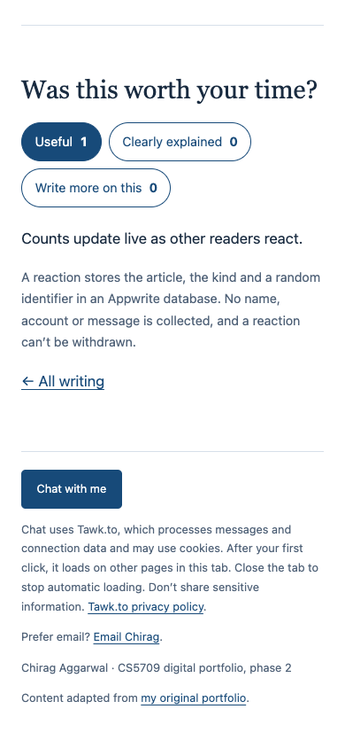
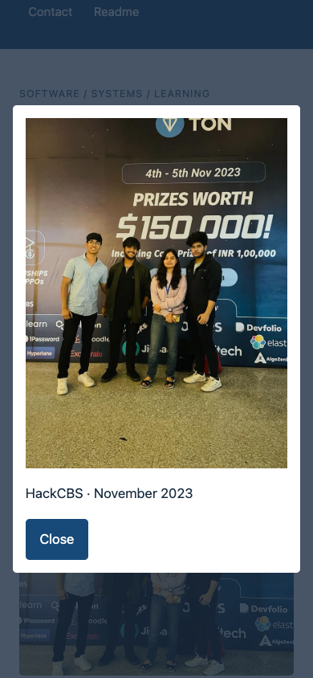
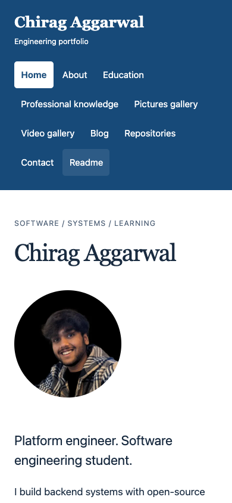

## Abstract

Phase 2 turns the Phase 1 static site (24 files generated by a Node.js script) into a React 19 and strict TypeScript application with 13 pages, live on GitHub Pages. Content now sits in typed JSON files and standalone article HTML documents rather than template strings, while Vite 8, React Router 7 and GSAP 3 handle bundling, lazy-loaded routes and motion-safe transitions.

A GitHub Actions pipeline lints with oxlint, checks Prettier formatting, runs 19 unit tests, verifies types, builds and deploys passing commits to GitHub Pages in about a minute. All eight scenarios pass on the live site at desktop and phone widths. However, the personas remain assumptions and no real users tested the site.

How can a maintainer tell which promises the deployed portfolio keeps? A targeted literature review informed the structure of the report. Repository inspection linked nine functional and ten non-functional requirements to implementation files and tests. Five design views describe who uses the portfolio, how its components fit together, how a reaction travels between browsers, where the application runs and what it stores. All 19 unit tests passed. A live walkthrough supplied observations for each scenario. The defect log records six fixed defects, three accepted and three open.

Comparing requirements with those observations exposed a difference in coverage. A single anonymous reaction changed the count in three open views. The keyboard walkthrough established that the menu and skip link worked, while the requirement applies to every control. A maintainer can see which interactions still need testing.

## 1. Introduction

### 1.1 Background

The Phase 2 reflection records one consequence of missing documentation: “Watching the reviewer's walkthrough fail on its very first step because there was no `/readme` page on the live site made the gap obvious in a way a rubric comment never did” (Aggarwal, 2026, §6).

Lehman (1980) argued that software used in a changing environment must itself change to remain useful. Parnas (1994) identified a cost of making those changes once the original design assumptions have been forgotten. A maintainer can make a locally sensible edit that undermines a decision elsewhere. Forward and Lethbridge (2002) found that practitioners still consulted documentation they knew was dated. An old architecture description can help someone find their way into the code, but its deployment instructions can send them to the wrong site. Aghajani et al. (2019) found both missing and incorrect information in their study of documentation issues. The missing Readme illustrates what an omission costs a reader even when the application itself runs.

Lecture 12 (Saay, 2026b) distinguishes process documentation, which records how and why a project changed, from product documentation, which explains how the current system works. Here the review log explains why the assessor needs a Readme reachable from the menu. The Phase 2 README and architecture views show which application serves that page and where its text comes from. With both phases still online, a maintainer needs the product documents to update the right file and the review history to know why the route must remain easy to find.

### 1.2 The system

The subject is a personal developer portfolio built for this module in two phases. Phase 1 (Assessment 1) was a static site of 11 pages generated by a Node.js script and hosted on Appwrite Sites; it remains live at https://chirag-cs5709.appwrite.network for comparison. Phase 2 (Assessment 3) rebuilt it as a React 19 and TypeScript single-page application with 13 pages, JSON-driven content, shared filter state, the GitHub REST API, an Appwrite database with realtime updates, and a GitHub Actions pipeline that deploys to GitHub Pages: https://chiragagg5k.github.io/ul-university-notes/. This report documents Phase 2 as it stands on 25 November 2026, with Phase 1 as its history (Aggarwal, 2026, §§1–3).

| Milestone | Date | Outcome |
| --- | --- | --- |
| Phase 1 submitted (Assessment 1) | 1 October 2026 | 12/15; feedback in Section 6.1 |
| Peer review of Phase 1 (Assessment 2) | 10 November 2026 (received) | 8 recommendations, 7 defects |
| Phase 2 submitted (Assessment 3) | 10 November 2026 | Corrected Phase 2 report submitted |
| Technical presentation (Assessment 4) | 22 November 2026 | 7-minute recorded walkthrough of both phases |
| This report (Assessment 5) | 4 December 2026 | Submission deadline |

### 1.3 Objectives and scope

The four objectives below group the nine functional and ten non-functional requirements. Section 2.4 lists the complete mapping.

| ID | Objective | Source |
| --- | --- | --- |
| O1 | Help an assessor locate the required pages and reach the Readme in one action | Assessment 1 and 3 briefs; peer review |
| O2 | Let a visitor reach evidence of a skill (code, article, project) quickly, on desktop or phone | Personas P2 and P3 |
| O3 | Let readers respond to the writing without accounts or a server of my own | Persona P3; innovation criterion |
| O4 | Keep the system easy to change: typed, documented, tested and deployed automatically after checks pass on site changes to main | Phase 1 feedback; peer review; Lehman (1980) |

**In scope:** the Phase 2 application under `Assignment 3/site/`, its pipeline, its database table, and its documentation. **Out of scope:** the content itself (biography, articles, photos), which is reused from my personal website, and the third-party services (Tawk.to, GitHub, Appwrite) beyond how the site uses them.

### 1.4 Method

A targeted literature review on 25 November 2026 started from Lecture 12 and the Phase 2 references. Searches used the terms “software documentation maintenance”, “software documentation quality” and the titles of the cited papers. Direct searches of IEEE Xplore, ACM Digital Library and Google Scholar were attempted. Their search pages required JavaScript or denied automated access, so discovery continued through indexed web searches, with publication details checked against DOI records, publisher catalogues and author copies. The selection retained empirical studies about producing, using or evaluating documentation, foundational work explaining change and design decisions, and standards relevant to a specific report section. Public standard descriptions and previews informed the structure. The table records the application of each finding. This was a targeted selection without exhaustive screening.

| Finding from the literature | Source | Applied in |
| --- | --- | --- |
| Requirements engineering produces defined information items. Here identifiers link each requirement to its source and verification | ISO/IEC/IEEE (2018) | Section 2: IDs, sources and verifying tests |
| A design description is organised as views, each answering a stakeholder concern | IEEE (2009); Kruchten (1995) | Section 3: use case, component, sequence, deployment and data views |
| A short decision record preserves the context and consequences of an architectural choice | Nygard (2011) | Section 3.5 |
| Maintainers encounter incomplete and inaccurate documentation | Forward & Lethbridge (2002); Aghajani et al. (2019) | Section 4: the Readme page renders the repository README; JSDoc in the source |
| Test documentation has a plan, case specifications and a completion report | ISO/IEC/IEEE (2021) | Section 5 |
| Inspection and dynamic testing find different defects | Fagan (1976); Myers et al. (2011) | Sections 5 and 6 |
| Continuing change creates pressure to manage complexity. Recording design assumptions helps later maintainers judge a change | Lehman (1980), Parnas (1994) | Sections 1.2 and 3.5 preserve the reason for the React port and its effect on deep links |
| In studies of maintenance work, older high-level descriptions could still orient a reader even after implementation details changed | Lethbridge et al. (2003) | Sections 3.2 and 6.3 distinguish the current component view from the historical Phase 1 measurements |
| A mapping study of 63 publications identified executable specifications as a way to maintain documentation during continuous development | Theunissen et al. (2022) | Section 5.3 includes results written by the scenario script itself |
| Library documentation quality has several dimensions. Tang and Nadi paired metrics with interviews and a survey to evaluate what developers found informative | Tang & Nadi (2023) | Section 6.3 distinguishes header coverage from usefulness to a reader |

### 1.5 Use of generative AI

Claude Code helped collect repository facts, draft tables and diagrams, and set up the report build. Codex assisted with the literature search, reference checks, technical editing, the live walkthrough and PDF verification. Codex also drafted the additions to the abstract, the background in §1.1 and the traceability judgement in §8. Passages reused from my earlier summary, critique and reflection are identified here and in the relevant sections (Aggarwal, 2026). The search in Section 1.4 was AI-assisted.

## 2. Requirements specification

Requirements were first written in Assessment 3, derived from three proto-personas (Cooper, 2004), eight scenarios (Carroll, 2000) and a review of four existing portfolios, as documented in Assessment 3 (Aggarwal, 2026, §2.4), after the Phase 1 feedback asked for requirements based on real cases rather than the developer's own view. This section restates them using the requirements information described by ISO/IEC/IEEE (2018) as a guide: each with an identifier, a priority, its source, and the test that verifies it. Non-functional requirements are grouped by the ISO/IEC (2023) product quality characteristics.

### 2.1 Stakeholders

| ID | Persona | Goal | Device and time |
| --- | --- | --- | --- |
| P1 | Module assessor | Confirm that each item in the brief exists and works | Desktop, about 15 minutes |
| P2 | Hiring manager | Find proof of one specific skill, and real code behind it | Often a phone, about 2 minutes |
| P3 | Fellow developer | Read an article, judge the author, perhaps respond | Usually a phone; sometimes keyboard only |

The eight scenarios S1–S8 that connect personas to requirements are listed with their test results in Section 5.3.

### 2.2 Functional requirements

| ID | Requirement | Priority | Objective | Source | Verified by | Implemented in |
| --- | --- | --- | --- | --- | --- | --- |
| FR1 | The Readme page is one action from any page | Must | O1 | P1, S1; peer review rec. 1 | S1 | `pages/Readme.tsx`, `data/navigation.json` |
| FR2 | Chat loads nothing from the provider before the visitor agrees, and always reports its state | Must | O1 | P1, S2 | S2 | `chat/loader.ts`, `components/Chat.tsx` |
| FR3 | A skill leads to its evidence in at most three actions | Must | O2 | P2, S3 | S3; filter unit tests | `components/CollectionFilter.tsx`, `state/matches.ts` |
| FR4 | Writing, projects and photos can be searched and filtered, and a filter survives navigation | Must | O2 | P2, S4; Assessment 3 brief | S4; reducer unit tests | `state/PortfolioContext.ts`, `hooks/useFilter.ts` |
| FR5 | A direct link to any page or article works | Must | O2 | P3, S5 | S5; content unit tests | `App.tsx`, `404.html` copy in the build |
| FR6 | A reader can react to an article without an account; counts are shared and update live | Should | O3 | P3, S5 | S5; identity unit tests | `components/Reactions.tsx`, `hooks/useReactions.ts`, `api/reactions.ts` |
| FR7 | Recent public work appears without manual updates | Should | O2 | P2, P3, S6; peer review (thin galleries) | S6 | `api/github.ts`, `pages/Repositories.tsx` |
| FR8 | Photos can be filtered and enlarged on a phone | Should | O2 | P2, S7 | S7 | `pages/Pictures.tsx` |
| FR9 | The site has the pages the brief names: Home, About, Education, Professional knowledge, Pictures, Videos, Blog, Contact with messaging, Readme | Must | O1 | Assessment 1 brief | S8; content unit tests | `App.tsx`, `pages/` |

### 2.3 Non-functional requirements

Rows marked † were not in the Assessment 3 list; they make explicit what the code already does, so they could be verified in Section 5.

| ID | Quality (ISO/IEC 25010) | Requirement | Objective | Source | Verified by |
| --- | --- | --- | --- | --- | --- |
| NFR1 | Interaction capability: accessibility | All controls should support keyboard operation. The skip link comes first and focus moves to the content after navigation | O2 | P3, S6 | S6 samples the menu and skip link |
| NFR2 | Interaction capability | Pages should fit a 390-pixel viewport | O2 | All, S8 | S8 checks ten routes, S5 checks one article |
| NFR3 | Interaction capability: accessibility | Motion is never forced on a visitor who asked for less | O2 | All | Inspection of `hooks/useReveal.ts` (no automated test) |
| NFR4 | Performance efficiency † | The first download holds only the frame, router and filter state; every page, article, SDK and the Markdown renderer load on demand | O2 | Assessment 3 brief (lazy loading) | Build output: 103 kB compressed first download |
| NFR5 | Reliability: fault tolerance † | The site stays usable when GitHub, Appwrite or Tawk.to fail; each states the failure | O2 | Assessment 3 defect log (I2) | Inspection; known issues in the README |
| NFR6 | Security † | The browser can write only what a visitor may do: the reactions table allows create and read, never update or delete; the pipeline restricts its deployment permissions | O3 | Assessment 3 design | Appwrite table permissions; workflow `permissions` |
| NFR7 | Security: privacy † | The reaction row contains no name or email; nothing loads from the chat provider before consent | O3 | P1, S2 | S2; schema in Section 3.4 |
| NFR8 | Maintainability | Strict types, one lint and format standard, a header comment on every file | O4 | Phase 1 feedback | Pipeline `check` job |
| NFR9 | Maintainability: modifiability | Content changes are edits to JSON or article HTML, never to components | O4 | Assessment 3 brief (JSON data) | Content unit tests |
| NFR10 | Flexibility: installability † | A push to `main` that passes every check is live without manual steps | O4 | Peer review rec. 6 | Pipeline runs (Section 5.4) |

### 2.4 Traceability summary

| Objective | Requirements |
| --- | --- |
| O1 Assessor finds everything | FR1, FR2, FR9 |
| O2 Evidence quickly, any device | FR3, FR4, FR5, FR7, FR8, NFR1–NFR5 |
| O3 Respond without accounts or a server | FR6, NFR6, NFR7 |
| O4 Easy to change | NFR8, NFR9, NFR10 |

## 3. Design description

The design is described in views, following IEEE (2009) and the view-based approach of Kruchten (1995). Each view answers one question. All diagrams are drawn in PlantUML from sources kept beside this report (`report/diagrams/`), so they can be regenerated when the system changes.

| View | Question it answers | Section |
| --- | --- | --- |
| Use case | Who uses the system for what? | 3.1 |
| Component | How is the code divided, and what depends on what? | 3.2 |
| Interaction (sequence) | How does the most complex feature work at run time? | 3.3 |
| Data | What is stored, and who may change it? | 3.4 |
| Deployment | Where does each part run, and how does a change get there? | 3.6 |

### 3.1 Use case view

<figure>

<figcaption>Figure 1. Use cases, from the personas and the functional requirements.</figcaption>
</figure>

### 3.2 Component view and technology stack

<figure>

<figcaption>Figure 2. Components, recovered from the import statements of <code>site/src</code>. Dashed arrows are dynamic imports, each a separate download.</figcaption>
</figure>

Dependencies point one way: pages depend on components and hooks, hooks on state and services, and nothing below depends on a page. GitHub and Appwrite access is isolated in `src/api/`. The rules most worth testing (`state/matches.ts`, the reducer in `state/PortfolioContext.ts`, `api/reactionIdentity.ts`) are pure functions with no browser dependency.

| Layer | Technology | Version | Role |
| --- | --- | --- | --- |
| Language | TypeScript, strict | 7 | Types checked before every build |
| UI | React | 19 | Components; `lazy` for per-route chunks |
| Routing | React Router | 7 | Client-side routes; base path from the pipeline |
| Build | Vite | 8 | Development server, bundling, code splitting |
| Motion | GSAP with `@gsap/react` | 3 | Entrance animation, skipped under reduced motion |
| Database and realtime | Appwrite Cloud (TablesDB, Realtime), Singapore region | SDK 29 | Article reactions |
| Outside data | GitHub REST API | v3 | Six most recently updated repositories |
| Messaging | Tawk.to | | Live chat, loaded after consent |
| Markdown | marked | 18 | Renders the README as the Readme page |
| Quality | oxlint, Prettier, Node test runner, Playwright | | Lint, format, unit tests, browser walkthrough |
| Hosting and CI/CD | GitHub Pages, GitHub Actions | | Static hosting; check and deploy on every push |

### 3.3 Interaction view: reacting to an article

<figure>

<figcaption>Figure 3. Reacting to an article, from <code>hooks/useReactions.ts</code> and <code>api/reactions.ts</code>.</figcaption>
</figure>

### 3.4 Data view

The only data the site writes is article reactions. Everything else is read-only content compiled into the build (`src/data/*.json` and `src/data/articles/*.html`).

<figure>

<figcaption>Figure 4. The <code>reactions</code> table in database <code>cs5709-portfolio</code>.</figcaption>
</figure>

| Content file | Holds | Read by |
| --- | --- | --- |
| `profile.json` | Name, biography, work history, contact details | Home, About, Contact |
| `education.json` | Degrees and courses | Education |
| `projects.json` | Case studies with skill tags and links | Knowledge |
| `photos.json` | Photo files, descriptions, tags | Pictures |
| `videos.json` | Video, poster, transcript, caption cues | Videos |
| `posts.json` | Article slugs, titles, dates, topics | Blog, Article |
| `navigation.json` | Menu order and labels | Layout |

### 3.5 Design decisions

These retrospective records follow Nygard (2011). Each links a choice to its implementation and consequence. Assessment 3 §5.5 discusses static HTML as an alternative in hindsight. The earlier report does not document a contemporaneous comparison of frameworks.

| ID | Context | Decision | Implementation evidence | Consequences |
| --- | --- | --- | --- | --- |
| D1 | The Phase 2 brief asks for components, JSON data, state, an API, lazy loading and animation | Rebuild as a React and TypeScript single-page application | `src/App.tsx:16` | Brief met; Phase 1 needed no JavaScript to read and served true HTTP statuses, Phase 2 does not (Aggarwal, 2026, §5.5) |
| D2 | The brief allows PropTypes or TypeScript | TypeScript in strict mode | `tsconfig.app.json:19` | Errors caught at build time, including JSON shape errors; adds a compile step |
| D3 | Filters must survive navigation between pages | `useReducer` and context above the router | `src/state/PortfolioProvider.tsx:9` | No extra dependency; filter state is not shareable as a link |
| D4 | GitHub Pages has no rewrite rule for client-side routes | Copy `index.html` to `404.html` at build time | `package.json:8` | Clean URLs work; first request to a deep link returns HTTP 404 |
| D5 | Reactions need shared, persistent, live state; the host serves static files only | Browser writes directly to an Appwrite table whose permissions allow only create and read | `src/api/reactions.ts:60` | No server to run; abuse limited to adding reactions; the endpoint and project are public constants |
| D6 | One reaction per stored visitor ID, article and kind | Row identifier built from a random visitor id, an article digest and the kind; the database rejects duplicates | `src/api/reactionIdentity.ts:33` | Uniqueness is per stored visitor ID, article and kind. Clearing storage permits another reaction |
| D7 | The README and the Readme page must not disagree (peer review rec. 1) | The page imports and renders the README file | `src/pages/Readme.tsx:14` | A single README serves both audiences; adds the Markdown renderer as a lazy chunk |


### 3.6 Deployment view

<figure>

<figcaption>Figure 5. Deployment, from <code>.github/workflows/cs5709-portfolio.yml</code>.</figcaption>
</figure>

## 4. Source code documentation

Documentation that lives apart from the code tends to go out of date (Forward & Lethbridge, 2002; Aghajani et al., 2019). The code is therefore documented in three places that change with it: a header comment and JSDoc in every source file, the repository `README.md` (also served as the site's Readme page), and this report's tables, which point to file paths rather than copying code.

### 4.1 Repository organisation

```
ul-university-notes/                         one repository for all coursework
  .github/workflows/cs5709-portfolio.yml     check and deploy pipeline
  2026-27/SEM1/CS5709 - Software Engineering Evolution/
    Assignment 1/site/                       Phase 1: Node static site generator
    Assignment 3/site/                       Phase 2: this system
      README.md                              technical documentation, also /readme
      package.json, vite.config.ts, tsconfig*.json
      public/assets/                         images and video, served as they are
      tests/                                 unit tests and the browser walkthrough
      src/
        main.tsx, App.tsx                    entry point and route table
        pages/        13 files               one per route
        components/   7 files                shared pieces
        hooks/        4 files                React glue to state and services
        state/        3 files                filter context, reducer, matching rules
        api/          3 files                GitHub and Appwrite calls
        chat/         1 file                 Tawk.to loader
        types/        1 file                 shapes of outside data
        data/         7 JSON + 2 articles    all content
        index.css                            one stylesheet, tokens at the top
    Assignment 5/report/                     this report and its diagrams
```

### 4.2 Modules

| Module | Responsibility | Main exports |
| --- | --- | --- |
| `App.tsx` | Route table; one lazy chunk per page | `App` |
| `components/Layout.tsx` | Frame, menu, skip link, focus after navigation | `Layout` |
| `components/CollectionFilter.tsx` | Search box, tag buttons, live result count; shared by three pages | `CollectionFilter` |
| `components/Reactions.tsx` | Reaction buttons and status line | `Reactions` |
| `components/Chat.tsx` | Chat button and its five states | `Chat` |
| `hooks/useFilter.ts` | One collection's filter from context | `useFilter` |
| `hooks/useReactions.ts` | Counts, realtime updates, own reactions, failure | `useReactions` |
| `hooks/useChat.ts` | Chat state as an external store | `useChat` |
| `hooks/useReveal.ts` | GSAP entrance, reduced-motion aware | `useReveal` |
| `state/PortfolioContext.ts` | Filter state shape, actions, reducer | `reduce`, `initialState`, `everyTag`, `PortfolioContext` |
| `state/PortfolioProvider.tsx` | Holds the reducer above the router | `PortfolioProvider` |
| `state/matches.ts` | Pure matching and tag rules | `matches`, `distinctTags` |
| `api/github.ts` | Latest repositories, with cancellation | `fetchRepositories` |
| `api/reactions.ts` | Count, add and watch reactions (dynamic import only) | `newVisitor`, `countReactions`, `addReaction`, `watchReactions` |
| `api/reactionIdentity.ts` | Reaction kinds and row-identifier rule; no SDK | `kinds`, `noCounts`, `digest`, `identify` |
| `chat/loader.ts` | Consent-gated Tawk.to loading and state | `load`, `open`, `subscribe`, `currentStatus`, `remembered` |
| `components/Page.tsx`, `ProjectCard.tsx`, `VideoPlayer.tsx` | Page heading and metadata; project card; video with captions and transcript | `Page`, `ProjectCard`, `VideoPlayer` |

### 4.3 Comments and coding standards

| Standard | How it is enforced | State on 25 November 2026 |
| --- | --- | --- |
| A `@file` header on every source file saying why it exists | Code review; Phase 1 feedback | 38 of 38 files |
| JSDoc on exported functions that are not self-evident | Code review | Present on all `api/`, `hooks/` and `state/` exports |
| One formatting standard | Prettier, checked in the pipeline | All files pass |
| Lint rules for React and TypeScript | oxlint, in the pipeline | 0 errors, 0 warnings |
| Strict typing | `tsc -b` before every build | 0 errors |

Example header, from `state/PortfolioContext.ts`:

```ts
/**
 * @file Shared filter state: one search text and one selected tag for each filterable collection.
 *
 * The state lives above the router, so a visitor who filters the projects, opens an article and
 * comes back finds the filter as they left it.
 */
```

### 4.4 Build, run and deploy

Requires Node 22.18 or newer. From `Assignment 3/site/`:

| Command | Does |
| --- | --- |
| `npm install` | Installs dependencies |
| `npm run dev` | Development server on http://localhost:5173 |
| `npm test` | 19 unit tests with the Node test runner |
| `npm run lint` | oxlint |
| `npm run build` | Type check, production build into `dist/`, copy of `index.html` to `404.html` |
| `npm run preview` | Serves `dist/` on http://localhost:4173 |
| `npm run walkthrough` | The eight scenarios in a real browser; `SITE=<url>` targets the live site |

Deployment needs no manual step. A push to `main` that changes the site runs the `check` job (install, lint, format check, unit tests, build) and, only if it passes, the `deploy` job, which publishes `dist/` to GitHub Pages. Pull requests and other branches run the checks only. Assessment 3 records the Appwrite table permissions (Aggarwal, 2026, §4); the web platform `chiragagg5k.github.io` is registered there so the browser may call it.

## 5. Test documentation

Test documentation follows the structure of ISO/IEC/IEEE (2021): a plan, the test cases, the results and the defects found.

### 5.1 Test plan

| Item | Plan |
| --- | --- |
| Scope | The Phase 2 site under `Assignment 3/site/`, built and live. Content accuracy and the third-party services themselves are out of scope |
| Levels and techniques | Unit tests on the pure rules and the content files; static analysis and type checking; a code inspection (Fagan, 1976); scenario-based system tests in a real browser, replaying S1–S8 (Carroll, 2000) |
| Environment | macOS, Node 22.19.0, Chrome; live site on GitHub Pages; Appwrite Cloud, Singapore region |
| Entry criteria | The build succeeds with no type errors, lint and format checks pass |
| Exit criteria | All unit tests and all eight scenarios pass on the live site; every defect logged with an outcome; no major defect open |
| Not tested | Real users; screen readers; message delivery through Tawk.to; behaviour at the GitHub API rate limit; load |
| Risks | The walkthrough writes a real reaction (scenario S5); third-party services may change |

### 5.2 Unit test cases

| File | Test case | Requirement |
| --- | --- | --- |
| `filter.test.ts` | An empty filter matches every item | FR4 |
| | A selected tag must be one of the item's tags | FR3 |
| | A tag is matched exactly, not as part of a longer tag | FR3 |
| | Search ignores case and surrounding spaces | FR4 |
| | Search also looks through the tags | FR4 |
| | Search and tag must both match | FR3, FR4 |
| | Distinct tags keep the order of first mention | FR3 |
| | Searching one collection leaves the others untouched | FR4 |
| | Selecting a tag keeps the search text | FR4 |
| | Reset returns a collection to the empty filter | FR4 |
| | The reducer never changes the state it was given | FR4 |
| `reactions.test.ts` | The same visitor, article and kind give the same identifier | FR6 |
| | A different article, kind or visitor gives a different identifier | FR6 |
| | Identifiers fit the database limit for every kind, however long the slug | FR6 |
| | The digest is always eight hexadecimal characters | FR6 |
| `content.test.ts` | Every navigation link has a route | FR5, FR9 |
| | Every post has an article file and a unique slug | FR5, NFR9 |
| | Every photo file exists and has a description | FR8, NFR9 |
| | Every project has tags and a link | FR3, NFR9 |

### 5.3 System test cases: scenario walkthrough

Each scenario is a script in `tests/walkthrough.mjs` that drives Chrome through Playwright, counts the actions, checks the end state and saves a screenshot.

The 25 November 2026 run targeted the deployed GitHub Pages URL. Each row and screenshot below comes from that run. S5 created one persistent reaction.

<!-- include ../evidence/walkthrough-2026-11-25/results.md -->

<figure class="shots phone">



</figure>
<p class="caption">Figure 6. End states of phone scenarios S5, S7 and S8 on the live site.</p>

### 5.4 Results

| Check | Result on 25 November 2026 |
| --- | --- |
| Unit tests (`npm test`) | 19 of 19 pass |
| Static analysis (`npm run lint`) | 0 errors, 0 warnings |
| Types (`tsc -b`, strict) | 0 errors |
| Formatting (`prettier --check src tests`) | All files pass |
| Build | Type check and production build passed. Vite reported 225 ms for bundling |
| Pipeline | Workflow definition inspected in `.github/workflows/cs5709-portfolio.yml`. The live walkthrough exercised the deployed version |
| Scenario walkthrough | 8 of 8 pass on 25 November 2026 (§5.3) |

### 5.5 Defect report

Defects were found by a single-author inspection of 38 source and test files adapted from Fagan (1976) and the module inspection lecture (Saay, 2026a) against the error categories of Myers et al. (2011), by the walkthrough, and by a review of the first Assessment 3 submission.

| ID | File | Category | Defect | Severity | Found by | Outcome |
| --- | --- | --- | --- | --- | --- | --- |
| I1 | `hooks/useReactions.ts` | Input/output | Damaged stored reactions threw while an article rendered | Medium | Inspection, then review | Fixed (239156d, 8284678) |
| I2 | `pages/Article.tsx` | Control flow | A failed article download left "Loading…" forever | Medium | Inspection | Fixed (239156d) |
| I3 | `hooks/useReactions.ts` | Control flow | Clicking before the realtime connection was up did not raise the count | Medium | Walkthrough S5 | Fixed before the first submission |
| I4 | `index.css` | Comments | 535 lines with no comment | Medium | Inspection | Fixed (239156d) |
| I5 | `pages/Videos.tsx` | Data reference | Introduction reads `videos[0]`; wrong once a second video is added | Minor | Inspection | Open |
| I6 | `api/github.ts`, `types/Repository.ts` | Interface | API response trusted without validation; unused field | Minor | Inspection | Open |
| I7 | `pages/Pictures.tsx` | Data reference | Enlarged view starts from `photos[0]`; empty list would fail | Minor | Inspection | Open |
| I8 | three files | Data reference | Three non-null assertions | Minor | Inspection | Accepted |
| I9 | `api/reactions.ts` | Data declaration | Service identifiers are constants in source | Minor | Inspection | Accepted |
| I10 | `tests/walkthrough.mjs` | Input/output | S5 writes a real reaction each run | Minor | Inspection | Accepted, documented |
| I11 | `hooks/useReactions.ts` | Comparison | Other tabs of the same reader kept a stale count | Medium | Review | Fixed (8284678) |
| I12 | `hooks/useReactions.ts` | Control flow | A reaction between counting and subscribing was missed | Minor | Review | Fixed (8284678) |

Six defects were fixed, three were accepted and three minor defects remain open in the assessed deployment. I5 and I7 affect changes to the current gallery data. I6 concerns unexpected data from GitHub. S6 and S7 exercise the normal responses and populated galleries. The next maintenance pass should exercise a second video, an empty photo collection and a malformed repository response before closing those entries.

## 6. Review documentation

The review compares the lecturer’s marking notes, the peer report and the Assessment 3 inspection log (Aggarwal, 2026, §§2, 5).

### 6.1 Reviews received

| Review | When | Reviewer | Method | Main findings |
| --- | --- | --- | --- | --- |
| Lecturer feedback, Phase 1 | 14 October 2026 | Dr Salim Saay | Marking against the Assessment 1 scheme | 12/15. Requirements set by the developer alone; no human-centred approach; code structure not explained in comments; review not structured or academic |
| Peer review, Phase 1 | Received 10 November 2026 | {{reviewer}} | Reverse engineering, architecture recovery, code inspection | 8 prioritised recommendations, 7 defects (D1–D7) |
| Self-inspection and walkthrough, Phase 2 | 10 November 2026 | Author | Fagan inspection, scenario walkthrough | 12 defects (Section 5.5) |
| Review of the first Phase 2 submission | 10 November 2026 | AI-assisted review | Code and report review | I11, I12, part of I1; claims beyond the evidence |

### 6.2 Feedback and improvements made

| Source | Feedback | Change made | Where |
| --- | --- | --- | --- |
| Lecturer, Phase 1 | Requirements determined solely by the developer | Personas, scenarios and a review of four portfolios; requirements traced to them | Section 2 |
| Lecturer, Phase 1 | A clear human-centred design approach is needed | Human-centred design cycle (International Organization for Standardization, 2019): context of use, requirements, design, evaluation against the same scenarios | Sections 2, 5.3 |
| Lecturer, Phase 1 | Code structure should be explained in comments | `@file` header on every file; comment lines from 2% to 12% | Section 4.3 |
| Lecturer, Phase 1 | The review can be more structured and academic | Named methods with entry and exit criteria and a defect log | Section 5 |
| Peer review rec. 1 | Add a Readme page | `/readme` renders the repository README | FR1, D7 |
| Peer review rec. 2 | Personas and scenarios; trace features | 3 personas, 8 scenarios, traced requirements | Section 2 |
| Review of first Phase 2 submission | S6 originally set focus from the script | Revised S6 to press Tab and Enter, then check focus. Its result applies to the two paths tested | Section 5.3, S6 |
| Self-evaluation | S5 exposed a race before realtime connected | Updated the local count after a successful write and replayed the multi-reader scenario | I3, Section 5.5 |
| Peer review rec. 3 | Analyse the lecturer's provided portfolio | Not carried out: Phase 1 was built from my own site, declared at the time | Section 6.4 |
| Peer review rec. 4 | Module view recovered from the code | Component view from imports | Section 3.2 |
| Peer review rec. 5 | Header comments; fix D1–D7 | 38 of 38 headers; D1–D7 fixed or no longer applicable | Section 4.3 |
| Peer review rec. 6 | Build and test in GitHub Actions | Pipeline with lint, format, tests, types, build; deploy on `main` | Section 4.4 |
| Peer review rec. 7 | Articles out of code; refactor chat | Articles as HTML files; chat loader as a store | Section 4.2 |
| Peer review rec. 8 | Split technical docs from working notes | `site/README.md` and `NOTES.md` | Section 4.1 |
| Peer review | Galleries thin | Repositories page from the GitHub API; photo and video counts unchanged | FR7 |

### 6.3 Evaluation results

| Measure | Phase 1 | Phase 2 |
| --- | --- | --- |
| Pages | 11 | 13 |
| Code files, lines | 24, 1,656 | 38, 1,980 (plus a 560-line stylesheet) |
| Comment lines | 31 (2%) | 232 (12%) |
| Automated tests | 26, against the build script | 19 unit tests, 8 browser scenarios |
| Deployment | Manual | Automatic on every push to `main` |
| Outside services | Tawk.to | Tawk.to, GitHub REST API, Appwrite |

Header coverage measures whether a file has an introduction. Reader comprehension would require a separate task with participants. Tang and Nadi (2023) similarly tested the interpretation of their documentation metrics with developers. Phase counts are from Aggarwal (2026, §5) and refer to the assessed versions.

### 6.4 Lessons learned

From my Phase 2 reflection (Aggarwal, 2026, §6):

Receiving the peer review taught me something different from the lecturer's marking notes. The lecturer's feedback pointed out the missing academic methods, such as personas and structured evaluation, whereas the peer review showed me what happens when another person actually tries to use the artefact to understand how it works. Watching the reviewer's walkthrough fail on its very first step because there was no `/readme` page on the live site made the gap obvious in a way a rubric comment never did.

The personas and scenarios arrived partway through Phase 2 rather than before the first commit: the initial React port, including keeping the filter state above the router, was already in place when I wrote them. Even so, writing them changed what was built next instead of merely documenting existing pages. Scenario S4 confirmed that the shared filter state was worth keeping, while the `/readme` route came from P1 and the article reaction bar exists only because of Persona P3, an engineer who follows a shared article link and wants a one-click way to say a post helped without opening a live chat or creating an account.

The evaluation also showed me why static inspection and dynamic testing cannot replace each other. Reading `useReactions.ts` during the inspection missed defect I3 because updating the counter from the Appwrite realtime echo looked clean on the page; the two-browser walkthrough script in Scenario S5 caught the race condition as soon as a click ran before the websocket finished connecting. Having the GitHub Actions pipeline run lint, formatting, unit tests and strict type checks on every push changed my workflow in the same way, turning verification into an automatic gate. Because I relied heavily on Claude Code to write the application, set up the Appwrite table and run the browser walkthrough, my own role was steering and reviewing: approving the move to GitHub Pages, deciding when to pause and resume the work, and checking that the report's claims matched the Git history and the live site. A Phase 3 would pre-render each route at build time to remove the GitHub Pages 404 workaround, expand the galleries, and test the site with real readers.

The workflow runs those push checks when a commit changes the Phase 2 site or the workflow file. The changes corresponding to these observations appear in §6.2 under lecturer feedback, peer recommendations 1 and 2, and self-evaluation. The distinction between inspection and execution follows Myers et al. (2011).

The first version of S6 claimed keyboard access after the script itself moved focus. Assessment 3 records how the review exposed that weakness (Aggarwal, 2026, §5.2). The revised test presses Tab and Enter to reach Repositories and the skip link (§6.2). It establishes where focus goes on those two paths. The wider keyboard requirement and the experience of screen-reader users still need evaluation (§§2.3, 5.1).

## 7. Innovation documentation

### 7.1 Live article reactions on a static host

GitHub Pages serves static files only: no server and no database. Persona P3 wants to respond to an article without an account or a message. Comparison with the Phase 1 deployment (Aggarwal, 2026, §§3–4) shows how Phase 2 gives the static site shared, persistent and live state: readers choose "Useful", "Clearly explained" or "Write more on this", and the counts rise in every open copy of the article when their subscribed clients receive the update. The design is in Sections 3.3, 3.4 and decisions D5 and D6.

| Technology | Category | What it adds | Justification |
| --- | --- | --- | --- |
| Appwrite TablesDB with row permissions | Cloud backend-as-a-service | A database the browser writes to safely, without a server | Permission model limits a hostile visitor to adding reactions (NFR6) |
| Appwrite Realtime over a websocket | Cloud, event-driven | Live counts in every open browser | P3 sees others' reactions without reloading |
| Deterministic row identifiers | Design technique | The database rejects duplicate row IDs | No accounts or sessions needed (NFR7) |
| Dynamic import of the SDK | Performance | The 29 kB compressed SDK loads only on article pages | First download stays small (NFR4) |

<figure>

<figcaption>Figure 7. Reactions on the live site.</figcaption>
</figure>

### 7.2 Supporting innovations

| Feature | What is new | Requirement |
| --- | --- | --- |
| Self-documenting Readme page | The site renders the repository README, so the two cannot drift | FR1, D7 |
| Executable scenarios | The personas' scenarios are a browser script that runs against local or live builds and records evidence | Section 5.3 |
| CI/CD to GitHub Pages | Passing changes to the site or its workflow on `main` go live in about a minute, with least-privilege permissions | NFR10 |
| Live GitHub repositories | Recent work appears without editing | FR7 |
| Diagrams as code | The UML in this report is generated from PlantUML sources in the repository | Section 3 |

As I wrote in the Phase 2 summary, “Beyond class coverage, articles feature reactions stored in an Appwrite database using deterministic row identifiers and table permissions without a custom server, with live counts pushed over websockets, alongside a Repositories page fed by the GitHub REST API” (Aggarwal, 2026, Summary). Appwrite describes the subscription as a channel for service events (Appwrite, n.d.). The pipeline and walkthrough also illustrate the use of executable development artefacts described by Theunissen et al. (2022). The Phase 2 critique describes the trade-off as “strict uniqueness for privacy and zero sign-up friction” (Aggarwal, 2026, §5.5). A visitor can clear browser storage and react again. The same create/read permissions that keep the application serverless prevent a reader from withdrawing a reaction. If Appwrite is unavailable, an article remains readable, but counts and voting depend on that service (`pages/Article.tsx`, `hooks/useReactions.ts`).

## 8. Conclusion

**Traceability.** FR6 is the strongest link between an objective and its evidence. Under O3, it requires that a reader can react without an account and others can see the count change (§2.2). In S5, one click on “Useful” took the count from zero to one in the reader’s tab, a second tab and another reader’s browser without a reload (§5.3). A maintainer can cite that run as direct evidence that an anonymous reaction reached all three views. NFR1 is the weakest link. It extends O2 to keyboard operation of every control (§2.3), while S6 used Tab and Enter to open Repositories from the menu and activate the skip link (§5.3). A maintainer can rely on those two observed focus paths. Keyboard operation of the reaction buttons and gallery controls, for example, remains unverified by S6.

**Evaluation.** From my Phase 2 critique (Aggarwal, 2026, §5.5): “Although Phase 2 resolves the structural gaps noted in both reviews, the discovery and evaluation work still stops short of real human validation.” The 25 November run passed all eight scenarios, while I5–I7 remain open (§§5.3–5.5). Screen-reader use was outside the test plan.

**Next iteration.** “If I were continuing the project tomorrow, the first thing I would fix is running a short think-aloud usability test with three real people before writing any more code” (Aggarwal, 2026, §5.5). A direct article link still returns HTTP 404 before rendering (§3.5, D4).

## References


<div class="references">

Aggarwal, C. (2026). *Digital portfolio, Phase 2* [Assessment 3 technical report]. University of Limerick.

Aghajani, E., Nagy, C., Vega-Márquez, O. L., Linares-Vásquez, M., Moreno, L., Bavota, G., & Lanza, M. (2019). Software documentation issues unveiled. In *Proceedings of the 41st International Conference on Software Engineering* (pp. 1199–1210). IEEE. https://doi.org/10.1109/ICSE.2019.00122

Appwrite. (n.d.). *Subscribe*. https://appwrite.io/docs/apis/realtime/subscribe

{{reviewerReference}} (2026). *CS5709 Assessment 2: Project peer review of "Digital portfolio, Phase 1"* [Unpublished student report]. University of Limerick.

Carroll, J. M. (2000). *Making use: Scenario-based design of human-computer interactions*. MIT Press.

Cooper, A. (2004). *The inmates are running the asylum: Why high-tech products drive us crazy and how to restore the sanity*. Sams.

Fagan, M. E. (1976). Design and code inspections to reduce errors in program development. *IBM Systems Journal, 15*(3), 182–211. https://doi.org/10.1147/sj.153.0182

Forward, A., & Lethbridge, T. C. (2002). The relevance of software documentation, tools and technologies: A survey. In *Proceedings of the 2002 ACM Symposium on Document Engineering* (pp. 26–33). ACM. https://doi.org/10.1145/585058.585065

IEEE. (2009). *IEEE standard for information technology: Systems design: Software design descriptions* (IEEE Std 1016-2009). https://doi.org/10.1109/IEEESTD.2009.5167255

International Organization for Standardization. (2019). *Ergonomics of human-system interaction: Part 210. Human-centred design for interactive systems* (ISO 9241-210:2019). https://www.iso.org/standard/77520.html

ISO/IEC. (2023). *Systems and software engineering: Systems and software quality requirements and evaluation (SQuaRE): Product quality model* (ISO/IEC 25010:2023). https://www.iso.org/standard/78176.html

ISO/IEC/IEEE. (2018). *Systems and software engineering: Life cycle processes: Requirements engineering* (ISO/IEC/IEEE 29148:2018). https://doi.org/10.1109/IEEESTD.2018.8559686

ISO/IEC/IEEE. (2021). *Software and systems engineering: Software testing: Part 3. Test documentation* (ISO/IEC/IEEE 29119-3:2021). https://doi.org/10.1109/IEEESTD.2021.9591577

Kruchten, P. B. (1995). The 4+1 view model of architecture. *IEEE Software, 12*(6), 42–50. https://doi.org/10.1109/52.469759

Lehman, M. M. (1980). Programs, life cycles, and laws of software evolution. *Proceedings of the IEEE, 68*(9), 1060–1076. https://doi.org/10.1109/PROC.1980.11805

Lethbridge, T. C., Singer, J., & Forward, A. (2003). How software engineers use documentation: The state of the practice. *IEEE Software, 20*(6), 35–39. https://doi.org/10.1109/MS.2003.1241364

Myers, G. J., Badgett, T., & Sandler, C. (2011). *The art of software testing* (3rd ed.). Wiley. https://doi.org/10.1002/9781119202486

Nygard, M. (2011, November 15). *Documenting architecture decisions*. Cognitect. https://cognitect.com/blog/2011/11/15/documenting-architecture-decisions

Parnas, D. L. (1994). Software aging. In *Proceedings of the 16th International Conference on Software Engineering* (pp. 279–287). IEEE. https://doi.org/10.1109/ICSE.1994.296790

Saay, S. (2026a). *Software inspection* [Lecture slides]. CS5709 Software Engineering Evolution, University of Limerick.

Saay, S. (2026b). *Software documentation* [Lecture slides]. CS5709 Software Engineering Evolution, University of Limerick.

Tang, H., & Nadi, S. (2023). Evaluating software documentation quality. In *2023 IEEE/ACM 20th International Conference on Mining Software Repositories* (pp. 67–78). IEEE. https://doi.org/10.1109/MSR59073.2023.00023

Theunissen, T., van Heesch, U., & Avgeriou, P. (2022). A mapping study on documentation in continuous software development. *Information and Software Technology, 142*, Article 106733. https://doi.org/10.1016/j.infsof.2021.106733

</div>
